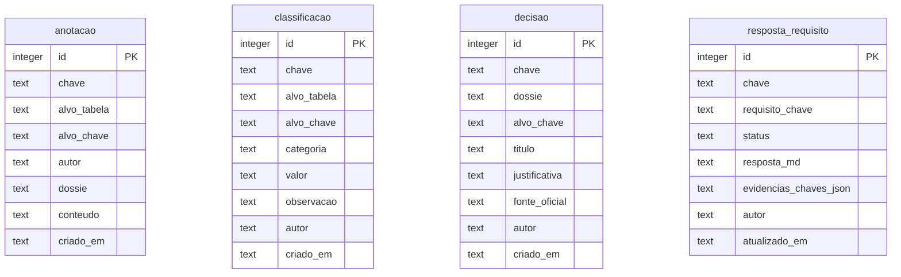

# Diagrama Entidade-Relacionamento (ER) — Laboratório Contábil

Documento gerado automaticamente por `python -m sistema.gerar_docs` a partir das FKs do SQLite.

## `laboratorio.db`

```mermaid
erDiagram
    bru_arquivo {
        integer id PK
        text chave
        text caminho_relativo
        text nome
        text extensao
        text sha256
        integer tamanho_bytes
        text dossie
        text dominio
        text papel_acervo
        integer zip_origem_id FK
        integer duplicata_de_id FK
        integer paginas_total
    }
    bru_celula {
        integer id PK
        text chave
        integer arquivo_id FK
        text aba
        integer ordem_aba
        integer linha
        integer coluna
        text endereco
        text tipo_dado
        text valor_texto
        text valor_cacheado
        text formula
        text formato_numero
        text destino
    }
    bru_linha {
        integer id PK
        text chave
        integer arquivo_id FK
        integer pagina
        integer n_linha
        text texto
        real x0
        real y0
        real tam_fonte
        text fonte
        text cor_hex
        integer eh_marca_dagua
        text destino
    }
    bru_paragrafo {
        integer id PK
        text chave
        integer arquivo_id FK
        integer ordem
        text origem_bloco
        integer tabela_idx
        integer linha_idx
        integer coluna_idx
        text estilo
        text texto
        text destino
    }
    bru_sigaa_item {
        integer id PK
        text chave
        integer ordem
        text status_fetch
        text content_type
        integer bytes_fetch
        text rotulo_sigaa
        text link_texto
        text dossie_inferido
        integer arquivo_id FK
        text observacao
    }
    bru_zip_entrada {
        integer id PK
        text chave
        integer zip_arquivo_id FK
        text caminho_interno
        integer tamanho_bytes
        integer crc32
        text sha256
        integer arquivo_disco_id FK
    }
    conferencia {
        integer id PK
        text chave
        text regra
        text severidade
        text registros_json
        text valores_json
        text status
        text descricao
    }
    evidencia {
        integer id PK
        text chave
        text tabela_destino
        text registro_chave
        text bru_tabela
        text bru_chave
    }
    ext_balancete_linha {
        integer id PK
        text chave
        integer arquivo_id FK
        text fonte
        text periodo
        text conta_codigo
        text conta_nome
        integer saldo_anterior_centavos
        integer debito_centavos
        integer credito_centavos
        integer saldo_atual_centavos
        text origem_valor
        integer celula_id FK
        integer linha_bruto_id FK
    }
    ext_campo {
        integer id PK
        text chave
        integer documento_id FK
        text secao
        text rotulo
        text valor_texto
        integer valor_centavos
        text moeda
        integer valor_micro
        text valor_data
        integer linha_bruto_id FK
    }
    ext_diario_lancamento {
        integer id PK
        text chave
        integer arquivo_id FK
        integer ano
        integer numero_lancamento
        text data_lancamento
        text historico
        text tag_ref
        integer linha_bruto_id FK
    }
    ext_diario_partida {
        integer id PK
        text chave
        integer lancamento_id FK
        integer ordem
        text conta_codigo
        text conta_nome
        text dc
        integer valor_centavos
        text valor_texto
        integer linha_bruto_id FK
    }
    ext_documento {
        integer id PK
        text chave
        integer arquivo_id FK
        text modelo
        text tipo
        text numero
        text serie
        text data_emissao
        text data_referencia
        text doc_ref
        text estabelecimento_prefixo
        integer valor_total_centavos
        text moeda
        text valor_total_texto
    }
    ext_estoque_linha {
        integer id PK
        text chave
        integer arquivo_id FK
        text aba
        integer ordem
        text produto_codigo
        text descricao
        text dados_json
        integer celula_id FK
    }
    ext_extrato_linha {
        integer id PK
        text chave
        integer arquivo_id FK
        text aba
        integer n_linha
        text conta_codigo
        text data_movimento
        text historico
        text doc_ref
        integer debito_centavos
        integer credito_centavos
        integer saldo_centavos
        text origem_valor
        integer celula_saldo_id FK
    }
    ext_item {
        integer id PK
        text chave
        integer documento_id FK
        text tabela
        integer n_linha
        text colunas_json
        integer linha_bruto_id FK
    }
    ext_material {
        integer id PK
        text chave
        integer arquivo_id FK
        text dossie
        text categoria
        text titulo
    }
    ext_nota_didatica {
        integer id PK
        text chave
        integer arquivo_id FK
        integer documento_id FK
        text texto
        integer linha_bruto_id FK
        integer celula_id FK
        integer paragrafo_id FK
    }
    ext_parametro_planilha {
        integer id PK
        text chave
        integer arquivo_id FK
        text aba
        text rotulo
        text valor_texto
        integer celula_id FK
    }
    ext_razao_linha {
        integer id PK
        text chave
        integer arquivo_id FK
        integer ano
        text conta_codigo
        text conta_nome
        integer ordem
        text data_movimento
        integer numero_lancamento
        text historico
        integer debito_centavos
        integer credito_centavos
        integer saldo_centavos
        text saldo_dc
        integer linha_bruto_id FK
    }
    ext_secao {
        integer id PK
        text chave
        integer material_id FK
        integer ordem
        text titulo
        text conteudo
        integer paragrafo_id FK
        integer linha_bruto_id FK
    }
    nrm_apuracao {
        integer id PK
        text chave
        integer empresa_id FK
        text tipo_apuracao
        text competencia
        integer receita_bruta_centavos
        integer rbt12_centavos
        integer tributo_apurado_centavos
        text doc_ref
    }
    nrm_cambio {
        integer id PK
        text chave
        integer estabelecimento_id FK
        text contrato_numero
        text data_contratacao
        text moeda_estrangeira
        integer valor_estrangeiro_centavos
        integer taxa_micro
        text taxa_texto
        integer principal_brl_centavos
        integer iof_centavos
        integer tarifa_centavos
        integer valor_total_brl_centavos
        integer exportador_pessoa_id FK
        text invoice_numero
        text doc_ref
    }
    nrm_ciclo_importacao {
        integer id PK
        text chave
        integer empresa_id FK
        text cambio_doc_ref
        text data_cambio
        text data_entrada_estoque
        text pais_origem
        integer principal_brl_centavos
        integer iof_centavos
    }
    nrm_comprovante {
        integer id PK
        text chave
        integer estabelecimento_id FK
        text subtipo
        text data_operacao
        integer valor_centavos
        text moeda
        integer contraparte_pessoa_id FK
        text doc_ref
    }
    nrm_conta_bancaria {
        integer id PK
        text chave
        integer empresa_id FK
        integer estabelecimento_id FK
        text banco_nome
        text agencia
        text conta_numero
        text descricao
    }
    nrm_conta_contabil {
        integer id PK
        text chave
        text codigo
        text nome
        integer grupo
        text natureza
    }
    nrm_contrato_credito {
        integer id PK
        text chave
        integer empresa_id FK
        text numero_contrato
        text data_contratacao
        integer principal_centavos
        text taxa_juros_texto
        text doc_ref
    }
    nrm_devolutiva {
        integer id PK
        text chave
        integer dossie_id FK
        text grupo
        integer nossa_dupla
        text nota_texto
        text resumo
        integer material_id FK
    }
    nrm_di {
        integer id PK
        text chave
        integer estabelecimento_id FK
        text numero_di
        text data_registro
        text moeda
        integer taxa_micro
        text taxa_texto
        integer valor_fob_moeda_centavos
        integer frete_seguro_moeda_centavos
        integer valor_aduaneiro_brl_centavos
        text doc_ref
    }
    nrm_di_adicao {
        integer id PK
        text chave
        integer di_id FK
        text numero_adicao
        text ncm
        integer valor_aduaneiro_centavos
        integer ii_centavos
        integer ipi_centavos
        integer pis_imp_centavos
        integer cofins_imp_centavos
    }
    nrm_documento_fiscal {
        integer id PK
        text chave
        integer estabelecimento_id FK
        text tipo_documento
        text numero
        text serie
        text chave_acesso
        text data_emissao
        integer emitente_pessoa_id FK
        integer destinatario_pessoa_id FK
        text natureza_operacao
        integer valor_total_centavos
        text moeda
        text doc_ref
    }
    nrm_documento_fiscal_item {
        integer id PK
        text chave
        integer documento_fiscal_id FK
        integer n_item
        integer produto_id FK
        text codigo_item_documento
        text descricao
        text ncm_hs
        text cfop
        text cst_csosn
        text unidade
        integer quantidade_micro
        integer valor_unitario_micro
        integer valor_total_centavos
        text moeda
    }
    nrm_dossie {
        integer id PK
        text chave
        text codigo
        text titulo
        text periodo_texto
        text prazo_texto
    }
    nrm_empresa {
        integer id PK
        text chave
        integer pessoa_id FK
        text nome_curto
        text papel_no_caso
    }
    nrm_estabelecimento {
        integer id PK
        text chave
        integer empresa_id FK
        text tipo
        text cnpj
        text uf
        text municipio
        text endereco
    }
    nrm_estoque_movimento {
        integer id PK
        text chave
        integer produto_id FK
        integer ciclo_importacao_id FK
        text tipo_movimento
        text data_movimento
        integer quantidade
        integer custo_unitario_centavos
        integer valor_total_centavos
    }
    nrm_evento {
        integer id PK
        text chave
        integer empresa_id FK
        text tipo_evento
        text data_evento
        text descricao
        text fonte_chave
    }
    nrm_fato {
        integer id PK
        text chave
        text sujeito_chave
        integer evento_id FK
        text atributo
        text valor_texto
        integer valor_centavos
        text vigente_de
        text vigente_ate
        text fonte_chave
    }
    nrm_fechamento_caixa {
        integer id PK
        text chave
        integer estabelecimento_id FK
        text data_fechamento
        integer valor_total_centavos
        text doc_ref
    }
    nrm_fechamento_caixa_dia {
        integer id PK
        text chave
        integer fechamento_id FK
        text data_dia
        integer valor_centavos
    }
    nrm_guia {
        integer id PK
        text chave
        integer estabelecimento_id FK
        text tipo_guia
        text competencia
        text data_vencimento
        integer valor_principal_centavos
        integer valor_total_centavos
        text uf
        text doc_ref
    }
    nrm_guia_composicao {
        integer id PK
        text chave
        integer guia_id FK
        text tributo_codigo
        text descricao
        integer valor_centavos
    }
    nrm_item_tributo {
        integer id PK
        text chave
        integer item_id FK
        integer documento_fiscal_id FK
        text tributo
        integer base_centavos
        integer aliquota_micro
        text aliquota_texto
        integer valor_centavos
    }
    nrm_lancamento {
        integer id PK
        text chave
        integer ano
        integer numero_lancamento
        text data_lancamento
        text historico
        text tag_ref
    }
    nrm_liquidacao_cartao {
        integer id PK
        text chave
        integer estabelecimento_id FK
        text data_liquidacao
        integer valor_bruto_centavos
        integer taxa_centavos
        integer valor_liquido_centavos
        text doc_ref
    }
    nrm_liquidacao_cartao_venda {
        integer id PK
        text chave
        integer liquidacao_id FK
        text data_venda
        text autorizacao
        text modalidade
        text parcela_texto
        integer valor_bruto_centavos
        integer valor_liquido_centavos
    }
    nrm_material {
        integer id PK
        text chave
        integer dossie_id FK
        text categoria
        text titulo
        integer arquivo_id FK
    }
    nrm_material_secao {
        integer id PK
        text chave
        integer material_id FK
        integer ordem
        text titulo
        text conteudo
    }
    nrm_memorando {
        integer id PK
        text chave
        integer estabelecimento_id FK
        text data_memorando
        text assunto
        integer valor_centavos
        text doc_ref
    }
    nrm_movimento_bancario {
        integer id PK
        text chave
        integer conta_bancaria_id FK
        text data_movimento
        text historico
        text doc_ref
        text tipo_dc
        integer valor_centavos
        integer saldo_apos_centavos
        text origem_saldo
    }
    nrm_nota_didatica {
        integer id PK
        text chave
        text origem_chave
        text texto
    }
    nrm_parcela {
        integer id PK
        text chave
        integer contrato_id FK
        integer numero_parcela
        text data_vencimento
        integer amortizacao_centavos
        integer juros_centavos
        integer total_centavos
        text situacao
    }
    nrm_participacao_societaria {
        integer id PK
        text chave
        integer empresa_id FK
        integer socio_pessoa_id FK
        integer quotas
        integer valor_centavos
        integer percentual_micro
        text papel
        text vigente_de
        text vigente_ate
        text fonte_chave
    }
    nrm_partida {
        integer id PK
        text chave
        integer lancamento_id FK
        integer ordem
        integer conta_id FK
        text dc
        integer valor_centavos
    }
    nrm_pessoa {
        integer id PK
        text chave
        text tipo_pessoa
        text nome_canonico
    }
    nrm_pessoa_identificador {
        integer id PK
        text chave
        integer pessoa_id FK
        text tipo_id
        text valor
        integer eh_ficticio
        text fonte_chave
    }
    nrm_pessoa_ocorrencia {
        integer id PK
        text chave
        integer pessoa_id FK
        text nome_impresso
        text identificador_impresso
        text papel
        text fonte_chave
    }
    nrm_produto {
        integer id PK
        text chave
        text codigo_interno
        text descricao
        text ncm
        text cest
        text origem
    }
    nrm_recibo {
        integer id PK
        text chave
        integer estabelecimento_id FK
        text subtipo
        text data_recibo
        text competencia
        integer beneficiario_pessoa_id FK
        integer valor_centavos
        text doc_ref
    }
    nrm_requisito {
        integer id PK
        text chave
        integer dossie_id FK
        text codigo
        text descricao
        text fonte_chave
    }
    nrm_saldo {
        integer id PK
        text chave
        integer conta_id FK
        text periodo
        text fonte
        integer saldo_anterior_centavos
        integer debito_centavos
        integer credito_centavos
        integer saldo_atual_centavos
    }
    nrm_tema {
        integer id PK
        text chave
        text termo
    }
    nrm_titulo {
        integer id PK
        text chave
        integer estabelecimento_id FK
        text subtipo
        text numero
        text data_vencimento
        integer valor_centavos
        integer beneficiario_pessoa_id FK
        text doc_ref
    }
    nrm_transacao {
        integer id PK
        text chave
        text regra_agrupamento
        text doc_ref
        integer estabelecimento_id FK
        text ano_mes
        text data_referencia
        text status_vinculo
    }
    nrm_transacao_membro {
        integer id PK
        text chave
        integer transacao_id FK
        text tabela_membro
        text membro_chave
        text papel_membro
        text criterio_vinculo
    }
    nrm_vinculo {
        integer id PK
        text chave
        integer tema_id FK
        text alvo_tabela
        text alvo_chave
        text criterio
    }
    bru_arquivo ||--o{ bru_arquivo : "duplicata_de_id"
    bru_arquivo ||--o{ bru_arquivo : "zip_origem_id"
    bru_arquivo ||--o{ bru_celula : "arquivo_id"
    bru_arquivo ||--o{ bru_linha : "arquivo_id"
    bru_arquivo ||--o{ bru_paragrafo : "arquivo_id"
    bru_arquivo ||--o{ bru_sigaa_item : "arquivo_id"
    bru_arquivo ||--o{ bru_zip_entrada : "arquivo_disco_id"
    bru_arquivo ||--o{ bru_zip_entrada : "zip_arquivo_id"
    bru_arquivo ||--o{ ext_balancete_linha : "arquivo_id"
    bru_arquivo ||--o{ ext_diario_lancamento : "arquivo_id"
    bru_arquivo ||--o{ ext_documento : "arquivo_id"
    bru_arquivo ||--o{ ext_estoque_linha : "arquivo_id"
    bru_arquivo ||--o{ ext_extrato_linha : "arquivo_id"
    bru_arquivo ||--o{ ext_material : "arquivo_id"
    bru_arquivo ||--o{ ext_nota_didatica : "arquivo_id"
    bru_arquivo ||--o{ ext_parametro_planilha : "arquivo_id"
    bru_arquivo ||--o{ ext_razao_linha : "arquivo_id"
    bru_arquivo ||--o{ nrm_material : "arquivo_id"
    bru_celula ||--o{ ext_balancete_linha : "celula_id"
    bru_celula ||--o{ ext_estoque_linha : "celula_id"
    bru_celula ||--o{ ext_extrato_linha : "celula_saldo_id"
    bru_celula ||--o{ ext_nota_didatica : "celula_id"
    bru_celula ||--o{ ext_parametro_planilha : "celula_id"
    bru_linha ||--o{ ext_balancete_linha : "linha_bruto_id"
    bru_linha ||--o{ ext_campo : "linha_bruto_id"
    bru_linha ||--o{ ext_diario_lancamento : "linha_bruto_id"
    bru_linha ||--o{ ext_diario_partida : "linha_bruto_id"
    bru_linha ||--o{ ext_item : "linha_bruto_id"
    bru_linha ||--o{ ext_nota_didatica : "linha_bruto_id"
    bru_linha ||--o{ ext_razao_linha : "linha_bruto_id"
    bru_linha ||--o{ ext_secao : "linha_bruto_id"
    bru_paragrafo ||--o{ ext_nota_didatica : "paragrafo_id"
    bru_paragrafo ||--o{ ext_secao : "paragrafo_id"
    ext_diario_lancamento ||--o{ ext_diario_partida : "lancamento_id"
    ext_documento ||--o{ ext_campo : "documento_id"
    ext_documento ||--o{ ext_item : "documento_id"
    ext_documento ||--o{ ext_nota_didatica : "documento_id"
    ext_material ||--o{ ext_secao : "material_id"
    nrm_ciclo_importacao ||--o{ nrm_estoque_movimento : "ciclo_importacao_id"
    nrm_conta_bancaria ||--o{ nrm_movimento_bancario : "conta_bancaria_id"
    nrm_conta_contabil ||--o{ nrm_partida : "conta_id"
    nrm_conta_contabil ||--o{ nrm_saldo : "conta_id"
    nrm_contrato_credito ||--o{ nrm_parcela : "contrato_id"
    nrm_di ||--o{ nrm_di_adicao : "di_id"
    nrm_documento_fiscal ||--o{ nrm_documento_fiscal_item : "documento_fiscal_id"
    nrm_documento_fiscal ||--o{ nrm_item_tributo : "documento_fiscal_id"
    nrm_documento_fiscal_item ||--o{ nrm_item_tributo : "item_id"
    nrm_dossie ||--o{ nrm_devolutiva : "dossie_id"
    nrm_dossie ||--o{ nrm_material : "dossie_id"
    nrm_dossie ||--o{ nrm_requisito : "dossie_id"
    nrm_empresa ||--o{ nrm_apuracao : "empresa_id"
    nrm_empresa ||--o{ nrm_ciclo_importacao : "empresa_id"
    nrm_empresa ||--o{ nrm_conta_bancaria : "empresa_id"
    nrm_empresa ||--o{ nrm_contrato_credito : "empresa_id"
    nrm_empresa ||--o{ nrm_estabelecimento : "empresa_id"
    nrm_empresa ||--o{ nrm_evento : "empresa_id"
    nrm_empresa ||--o{ nrm_participacao_societaria : "empresa_id"
    nrm_estabelecimento ||--o{ nrm_cambio : "estabelecimento_id"
    nrm_estabelecimento ||--o{ nrm_comprovante : "estabelecimento_id"
    nrm_estabelecimento ||--o{ nrm_conta_bancaria : "estabelecimento_id"
    nrm_estabelecimento ||--o{ nrm_di : "estabelecimento_id"
    nrm_estabelecimento ||--o{ nrm_documento_fiscal : "estabelecimento_id"
    nrm_estabelecimento ||--o{ nrm_fechamento_caixa : "estabelecimento_id"
    nrm_estabelecimento ||--o{ nrm_guia : "estabelecimento_id"
    nrm_estabelecimento ||--o{ nrm_liquidacao_cartao : "estabelecimento_id"
    nrm_estabelecimento ||--o{ nrm_memorando : "estabelecimento_id"
    nrm_estabelecimento ||--o{ nrm_recibo : "estabelecimento_id"
    nrm_estabelecimento ||--o{ nrm_titulo : "estabelecimento_id"
    nrm_estabelecimento ||--o{ nrm_transacao : "estabelecimento_id"
    nrm_evento ||--o{ nrm_fato : "evento_id"
    nrm_fechamento_caixa ||--o{ nrm_fechamento_caixa_dia : "fechamento_id"
    nrm_guia ||--o{ nrm_guia_composicao : "guia_id"
    nrm_lancamento ||--o{ nrm_partida : "lancamento_id"
    nrm_liquidacao_cartao ||--o{ nrm_liquidacao_cartao_venda : "liquidacao_id"
    nrm_material ||--o{ nrm_devolutiva : "material_id"
    nrm_material ||--o{ nrm_material_secao : "material_id"
    nrm_pessoa ||--o{ nrm_cambio : "exportador_pessoa_id"
    nrm_pessoa ||--o{ nrm_comprovante : "contraparte_pessoa_id"
    nrm_pessoa ||--o{ nrm_documento_fiscal : "destinatario_pessoa_id"
    nrm_pessoa ||--o{ nrm_documento_fiscal : "emitente_pessoa_id"
    nrm_pessoa ||--o{ nrm_empresa : "pessoa_id"
    nrm_pessoa ||--o{ nrm_participacao_societaria : "socio_pessoa_id"
    nrm_pessoa ||--o{ nrm_pessoa_identificador : "pessoa_id"
    nrm_pessoa ||--o{ nrm_pessoa_ocorrencia : "pessoa_id"
    nrm_pessoa ||--o{ nrm_recibo : "beneficiario_pessoa_id"
    nrm_pessoa ||--o{ nrm_titulo : "beneficiario_pessoa_id"
    nrm_produto ||--o{ nrm_documento_fiscal_item : "produto_id"
    nrm_produto ||--o{ nrm_estoque_movimento : "produto_id"
    nrm_tema ||--o{ nrm_vinculo : "tema_id"
    nrm_transacao ||--o{ nrm_transacao_membro : "transacao_id"
```

## `trabalho.db`



