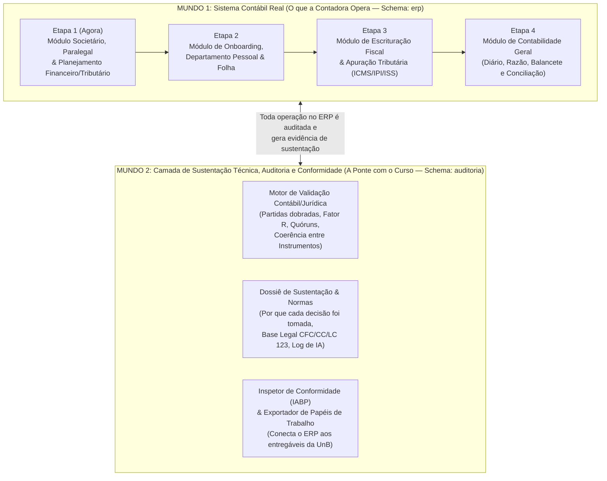

# Plano de Arquitetura e Implementação — Plataforma Contábil Real (Etapa 1: Societário, Legalização e Planejamento Financeiro/Tributário)

> **Documento de Controle de Arquitetura (`plataforma/docs/plano_plataforma_contabil_etapa1.md`)**  
> **Banco de Dados:** PostgreSQL 17 (`lab_contabil` — schemas `erp`, `auditoria`, `acervo`)  
> **Diretriz Central:** Construir um **Sistema Contábil e de Gestão Societária/Tributária real** (onde a contadora cadastra, simula, investiga, interpreta e toma decisões técnicas via CRUD), acoplado a uma **Camada de Sustentação e Conformidade** que conversa com as exigências e entregas do Laboratório Contábil (UnB).

---

## 1. Visão de Produto: "Os Dois Mundos" (Por que NÃO é uma "Plataforma de Curso")

O risco de construir um sistema guiado apenas pelos enunciados da disciplina é criar um "formulário escolar" descartável, onde a contadora apenas preenche caixas de texto para entregar um PDF. Isso descaracteriza a prática contábil e enfraquece a **sustentação técnica** (que vale nota de auditoria e defesa oral).

Por outro lado, construir um ERP contábil completo do zero de uma só vez é inviável. A estratégia correta é **usar cada etapa do curso como o gatilho incremental de construção dos módulos reais de um Sistema Contábil profissional**:

### Como os Dois Mundos funcionam juntos na prática
1. **Na superfície principal (Mundo 1 — ERP Contábil):** a contadora não vê "Responder Questão do Dossiê 1". Ela opera um **Sistema de Escritório Contábil**:
   - Cadastra uma **Empresa** (`erp.empresa`), seus **Estabelecimentos** (`erp.estabelecimento`), seu **Quadro Societário e Responsável Técnico CRC** (`erp.pessoa`, `erp.participacao_societaria`) e seu **Enquadramento Tributário Temporal** (`erp.enquadramento_historico`).
   - Redige e parametriza os **Instrumentos Societários** daquela empresa (Acordo de Sócios / MoU e Contrato Social), onde o sistema valida quóruns, alçadas, método de avaliação de haveres e impedimentos legais.
   - Executa o **Processo Paralegal de Abertura e Licenciamento** (Redesim, Viabilidade JUCIS-DF / Administração Regional, DBE, CNPJ, CF/DF SEEC-DF, RLE, Registro Cadastral no CRCDF).
   - Monta o **Orçamento, Planejamento Tributário e Viabilidade de 36 Meses** da empresa (simulando rampa de faturamento, Simples Nacional por faixa de `RBT12`, Fator R $\ge 28\%$, folha/pró-labore, DRE, Fluxo de Caixa, Balanço Patrimonial fechado por partida dobrada e análise de investimento VPL/TIR/Payback/Cenários).
2. **Na lateral / bastidor (Mundo 2 — Sustentação e Conformidade com o Curso):**
   - Enquanto ela opera o sistema contábil, o **Inspetor de Conformidade e Sustentação** verifica automaticamente se os dados cadastrados atendem às normas técnicas (Código Civil, Lei 14.451/2022, LC 123/2006, Res. CFC 1.707 e 1.708/2023) e aos **200 critérios de boas práticas das Matrizes da disciplina**.
   - Permite que ela registre a **Fundamentação Técnica / Parecer da Contadora** em cada decisão (preparando-a diretamente para sustentar o trabalho perante os professores).
   - Compila e exporta, a partir do banco de dados, os documentos formais exigidos em cada entrega da disciplina.

---

## 2. Validação de Enviesamento sobre `G:\Meu Drive\Nath\Trabalho 01`

A auditoria somente-leitura realizada na pasta `G:\Meu Drive\Nath\Trabalho 01` confirmou exatamente o risco que você levantou: **há três tipos de informação misturados naquela pasta**, e tratá-los como "dados prontos" contaminaria o sistema e tiraria da contadora o papel de investigar e decidir.

### Matriz de Triagem e Desenviesamento dos Dados Encontrados

| Categoria | O que foi encontrado em `G:\Meu Drive\Nath\Trabalho 01` | Risco de Enviesamento / Problema Detectado | Como a Plataforma vai Tratar (Quarentena + Investigação) |
|---|---|---|---|
| **1. Fatos e Decisões Originais da Dupla (`v1` — `_originais/` e `orig_*`)** | Sociedade *Prisma JRNA Auditoria e Contabilidade Ltda.* (`50%/50%` Nathalia e Jeovanna); sede na Asa Sul (DF); capital `R$ 40.000` (`R$ 10k` CAPEX + `R$ 30k` giro); Nathalia como administradora/RT (`CRC-DF`); alçada conjunta acima de `R$ 15.000`; ticket médio base `R$ 1.500/mês`; trava de pró-labore nos 3 primeiros meses e `R$ 4.500/mês` depois. | Na `v1`, essas escolhas foram lançadas **sem validação cruzada**: o pró-labore de `R$ 0` (M1–M3) e `R$ 4.500` (M4–M12) derrubava o Fator R para `< 28%` (caindo no Anexo V a `15,5%`), mas a planilha calculava DAS fixo de `6%`; o MoU usava **FCD de 5 anos** e o Contrato usava **Balanço de Determinação**; quórum de maioria simples (`>50%`) era impossível em sociedade `50%/50%`. | Entram no banco como **Parâmetros Base da Empresa**, porém com **Alertas Contábeis/Jurídicos Ativos** no motor de validação para a contadora investigar e decidir como sanear. |
| **2. Premissas Assumidas por IA sem Homologação (`rascunho v2` — `_entrega_limpa_Dossie1/`)** | **(a)** Divisão inventada de faturamento: `85%` no CNAE `6920-6/01` (tratado como Anexo III puro) e `15%` no CNAE `6920-6/02` (sujeito ao Fator R) para tentar justificar `R$ 0` de pró-labore nos meses 1 a 3. **(b)** Dados cadastrais fictícios preenchidos automaticamente (CNPJ `48.123.456/0001-90`, CPFs, RGs, endereço SCS Q. 06 Bl. A Sala 901). **(c)** Declaração de pesquisa de campo (`Bloco D2`) reescrita como "protocolo exploratório simulado". | **Alto risco de enviesamento na defesa oral:** se o professor perguntar *"De onde saiu que 85% da receita é contabilidade pura e 15% é consultoria, e como vocês tributaram o CNAE 6920-6/02 no Anexo V nos meses 1 a 3?"*, a contadora não pode ser pega de surpresa por uma premissa que ela própria não simulou nem escolheu! | Entram no banco com `status_revisao = 'pendente_revisao_contadora'` e flag **`premissa_nao_homologada = true`**. A interface obriga a contadora a comparar as alternativas no simulador e **homologar explicitamente** (ou alterar) a premissa escolhida. |
| **3. Lacunas Reais da 1ª Entrega apontadas pela Banca (`Devolutiva_Dossie1_G07.docx` — Nota `4,77`)** | • **Fluxo de Abertura no DF:** não entregue (`0,0`). • **Memorando (`2,8`):** faltavam 23 elementos da matriz (vinculação, prazo, boa-fé, vesting, aportes, quóruns, LGPD, ética, shotgun completa). • **Plano (`6,5`):** sem Balanço Patrimonial, sem VPL/TIR calculados sobre fluxo, sem Análise de Sensibilidade (`H7`), sem TAM/SAM/SOM quantificado (`C1`), DRE Anos 2–3 desconectada da carteira de clientes. • **Pesquisa (`5,0`):** Q1, Q4, Q5, Q9 e Q10 incompletas; Q6 copiada literal. | Se a contadora apenas aceitar um texto pronto sem passar pelo cálculo e pela revisão cláusula a cláusula, ela não constrói o domínio técnico exigido pela disciplina. | O sistema carrega a **Crítica Literal da Banca** vinculada a cada cláusula, conta ou etapa do fluxo, permitindo que a contadora **interprete o erro da v1, edite/recalcule no sistema e valide a correção**. |

---

## 3. Redesenho Semântico do Banco PostgreSQL (`003_erp_societario_planejamento.sql`)

Para eliminar o viés de "sistema escolar" no banco de dados (`lab_contabil`), as tabelas de trabalho deixam de ter prefixo escolar `d1_*` e passam a ter **nomes de domínio de um ERP Contábil real** (válidas para **qualquer** empresa cadastrada em `erp.empresa` — seja o escritório *Prisma JRNA* hoje, seja a *Rota Sul* ou *Meia Ponte* nas próximas etapas):

| Nome Anterior (Viés Escolar) | Novo Nome de Domínio no ERP (`schema: erp` / `auditoria`) | Função no Sistema Contábil Real |
|---|---|---|
| `erp.d1_plano_cenario` | **`erp.orcamento_cenario`** | Cenários orçamentários e tributários de qualquer empresa (`base`, `pessimista`, `otimista`, `tese_fator_r`, etc.), com TMA, ticket médio, mix de CNAEs, CAPEX, giro e inadimplência. |
| `erp.d1_plano_projecao_mensal` | **`erp.orcamento_projecao_mensal`** | Projeção operacional, tributária e contábil mês a mês (`M1`–`M36`): clientes, receita por CNAE, folha/pró-labore, `RBT12`, Fator R, Anexo do Simples, alíquota efetiva, DAS, custos fixos, DRE, Fluxo de Caixa e Balanço. |
| `erp.d1_clausula_societaria` | **`erp.instrumento_societario_clausula`** | Cláusulas estruturadas dos instrumentos societários da empresa (`acordo_socios_mou`, `contrato_social`, `alteracao_contratual`), com controle de versão, vigência, alçada, quórum e trava de consistência entre instrumentos. |
| `erp.d1_fluxo_etapa` | **`erp.processo_legalizacao_etapa`** | Etapas do workflow paralegal de abertura/alteração societária (Redesim, JUCIS-DF, Adm. Regional, RFB/DBE, SEEC-DF, RLE, CRCDF), com órgão, protocolo, documento gerado e fluxo de exigência/retorno. |
| `erp.d1_pesquisa_resposta` | **`erp.consulta_normativa`** | Base de consultas e pareceres normativos do escritório (questão técnica, interpretação autoral da contadora, norma/artigo CFC/CC/DREI/LC 123, link oficial, data de acesso e impacto nas decisões da empresa). |
| `erp.d1_matriz_criterio` | **`auditoria.criterio_conformidade`** | Catálogo dos **200 critérios técnicos** de auditoria e boas práticas (Plano, Contrato, MoU, Legalização DF), desacoplado em `auditoria.*`. |
| `auditoria.avaliacao_iabp` | **`auditoria.avaliacao_conformidade`** | Autoavaliação e auditoria técnica por empresa $\times$ critério (`0–4` ou `NA`), guardando a crítica da avaliação anterior, a evidência no ERP e a justificativa de sustentação da contadora. |

### Colunas de Governança Anti-Enviesamento em Todas as Tabelas Editáveis
Toda tabela de trabalho da contadora no `erp` terá:
- `origem_registro TEXT NOT NULL CHECK (origem_registro IN ('acervo_sigaa', 'importado_v1', 'importado_rascunho_v2', 'usuario'))`
- `status_validacao TEXT NOT NULL DEFAULT 'pendente_revisao' CHECK (status_validacao IN ('pendente_revisao', 'alerta_inconsistencia', 'homologado_contadora'))`
- `referencia_v1_original TEXT` (o valor/texto que existia na 1ª tentativa, para comparação histórica)
- `apontamento_auditoria TEXT` (a crítica técnica da banca ou o alerta de premissa assumida que exige validação)
- `justificativa_contadora TEXT` (a anotação de sustentação técnica da contadora explicando **por que** ela definiu aquele valor/cláusula).

---

## 4. Arquitetura das 5 Estações de Trabalho da Contadora (CRUD + Investigação + Interpretação)

A interface web (Flask + Jinja2 + HTMX sobre o PostgreSQL 17 `lab_contabil`) será organizada como um **Sistema Contábil Modular**, onde cada tela combina **CRUD Completo** + **Motor de Cálculo/Validação** + **Painel Lateral de Sustentação Técnica**:

### Estação 1 — Módulo Societário: Cadastro da Empresa, QSA e Enquadramento Temporal
- **O que ela faz (CRUD):**
  - Cria/edita a empresa (`erp.empresa`), endereço/estabelecimentos (`erp.estabelecimento`), sócios e responsável técnico com CRC (`erp.pessoa`, `erp.pessoa_identificador`, `erp.participacao_societaria`) e histórico de enquadramento (`erp.enquadramento_historico`: porte `ME` $\rightarrow$ `EPP`, regime tributário, CNAEs principal e secundários) e eventos temporais (`erp.evento`, `erp.fato`).
- **O que ela investiga e valida:**
  - Verifica a consistência cadastral (soma das quotas = `100%` do capital; presença obrigatória de sócia contadora com CRC ativo como Responsável Técnica pela Res. CFC `1.708/2023`; compatibilidade dos CNAEs `6920-6/01` e `6920-6/02` com o Simples Nacional).
  - Revisa e homologa (ou altera) os dados fictícios didáticos que estavam em aberto (`PONTOS_EM_ABERTO_DOSSIE1.md`).

### Estação 2 — Módulo Societário: Instrumentos Societários (Acordo de Sócios / MoU $\leftrightarrow$ Contrato Social)
- **O que ela faz (CRUD):**
  - Cria, edita, reordena, versiona e exclui cláusulas em `erp.instrumento_societario_clausula`, indicando se a regra governa o **MoU**, o **Contrato Social** ou **ambos**.
- **O que ela investiga e valida (Motor de Coerência Societária):**
  - **Comparador `v1` $\times$ `Atual`:** vê como a cláusula estava na `v1`, qual foi o apontamento da auditoria/banca e edita a redação definitiva.
  - **Trava Automática de Conflitos entre MoU, Contrato e Plano:**
    - *Apuração de Haveres:* alerta erro se o MoU estipular `FCD` e o Contrato estipular `Balanço de Determinação`.
    - *Paridade Societária (`50%/50%`):* alerta impedimento se qualquer cláusula exigir *"maioria do capital"* para destituição de administradora ou exclusão de sócia sem cláusula escalonada de desempate (mediação $\rightarrow$ *shotgun* / *buy-or-sell* $\rightarrow$ art. `1.030` CC).
    - *Governança e Remuneração:* verifica se alçada (`R$ 15.000`), *vesting* (`24 meses`) e regra de pró-labore batem com o Módulo de Planejamento Financeiro.

### Estação 3 — Módulo Paralegal: Workflow de Legalização e Abertura no DF (Redesim / JUCIS-DF / CRCDF)
- **O que ela faz (CRUD):**
  - Cadastra, edita, reordena e exclui etapas em `erp.processo_legalizacao_etapa` (órgão responsável, link oficial, data de consulta, documentos de entrada, documento/registro gerado, classificação de risco e regra de retorno em caso de exigência/indeferimento).
- **O que ela investiga e valida:**
  - Valida a especificidade tributária e administrativa do **Distrito Federal** (ausência de município: viabilidade de endereço na **Administração Regional / LUOS**, viabilidade de nome e NIRE na **JUCIS-DF**, DBE/Integrador RFB, inscrição tributária única **CF/DF na SEEC-DF** para ISS/ICMS, licenciamento **RLE** e registro cadastral obrigatório no **CRCDF**).
  - Visualiza o **Fluxograma BPMN / Mermaid** gerado dinamicamente a partir das etapas que ela cadastrou no banco.

### Estação 4 — Módulo de Planejamento Financeiro, Tributário & Viabilidade (36 Meses / 3 Anos)
- **O que ela faz (CRUD):**
  - Cria, clona, edita e exclui cenários em `erp.orcamento_cenario` e edita as premissas operacionais, tributárias e financeiras (rampa mensal de clientes `M1`–`M36`, ticket médio, % de receita por CNAE, pró-labore das sócias, contratações CLT, custos fixos discriminados, CAPEX, depreciação, inadimplência e TMA).
- **O que ela investiga, simula e interpreta (Motor Contábil-Tributário):**
  - **Simulador Comparativo de Tese Tributária (Simples Nacional + Fator R):**
    - Permite à contadora simular e comparar o impacto financeiro real de:
      1. *Manter trava de pró-labore (`R$ 0` em M1–M3 e `R$ 4.500` em M4–M12) com receita segregada entre `6920-6/01` (Anexo III) e `6920-6/02` (Anexo V quando Fator R $< 28\%$)*; **vs.**
      2. *Tributar a operação pelo Fator R global ajustando pró-labore/folha para $\ge 28\%$ (Anexo III) ou assumindo Anexo V quando $< 28\%$*.
    - Mostra mês a mês: `RBT12`, Folha Acumulada 12m, `% Fator R`, Anexo aplicável, Alíquota Nominal, Parcela a Deduzir, **Alíquota Efetiva Real** e valor do DAS.
  - **Alerta Automático de Transição de Porte (`ME` $\rightarrow$ `EPP`):** sinaliza o mês/ano exato em que a receita acumulada ultrapassa `R$ 360.000,00`.
  - **Demonstrações Contábeis e Indicadores Calculados pelo Sistema:**
    - **DRE Mensal (12M) e Anual (Anos 1, 2 e 3)** conciliada com a rampa de clientes e com a PDD/inadimplência de `5%`.
    - **Fluxo de Caixa e Balanço Patrimonial Projetado (Anos 1, 2 e 3)** com validação automática da equação patrimonial ($\text{Ativo} - (\text{Passivo} + \text{PL}) = \text{R\$ } 0,00$).
    - **Ponto de Equilíbrio Contábil e Financeiro**, **Unit Economics (`LTV` sobre margem de contribuição líquida, `CAC`, `LTV/CAC` e Payback do CAC)**, **VPL**, **TIR**, **Payback Descontado** (à TMA informada) e **Matriz de Sensibilidade (Pessimista / Base / Otimista)**.

### Estação 5 — Módulo de Consultas Normativas, Governança de IA & Conformidade (Ponte com o Curso)
- **O que ela faz (CRUD):**
  - Cadastra e edita as consultas normativas (`erp.consulta_normativa`: questões técnicas sobre registro profissional, responsabilidade técnica, Redesim e decisões do escritório, com artigo legal, link oficial e data de acesso).
  - Cadastra e edita o **Diário de Uso e Validação Humana de IA** (`auditoria.diario_ia`).
  - Executa a **Autoavaliação e Sustentação Técnica** sobre os **200 critérios** (`auditoria.avaliacao_conformidade`), filtrando pendências, atribuindo nota (`0–4` / `NA`), vinculando à cláusula/conta do ERP e exportando os documentos finais limpos (`.md` / `.docx` / `.xlsx`).

---

## 5. Etapas de Execução Propostas (Checkpoints Controlados)

Para mantermos controle total e sem atropelos, dividimos a execução em **3 entregas curtas e verificáveis**:

| Etapa | Escopo | Entregável Concreto e Verificação |
|---|---|---|
| **Etapa A — Schema ERP + Importação em Quarentena (Desenviesada)** | 1. Aplicar `003_erp_societario_planejamento.sql` no PostgreSQL 17 (`lab_contabil`). 2. Rodar `importar_rascunhos_nath.py` carregando `v1` e `rascunho v2` com `status_validacao = 'pendente_revisao'` e todos os alertas de enviesamento/devolutiva explícitos. | Tudo visível e consultável no **DBeaver** (`erp.orcamento_cenario`, `erp.instrumento_societario_clausula`, `erp.processo_legalizacao_etapa`, `erp.consulta_normativa`, `auditoria.avaliacao_conformidade`) + testes `pytest` verdes. |
| **Etapa B — Motor Contábil-Tributário & Validador de Coerência** | Implementar `sistema/erp/motor_contabil.py` (cálculo de Simples Nacional progressivo, Fator R, DRE, Fluxo de Caixa, Balanço Patrimonial fechado, Break-even, VPL/TIR/Sensibilidade e detector de conflitos MoU $\times$ Contrato $\times$ Cadastro). | Suíte `pytest` provando matematicamente o fechamento contábil ($\text{Ativo} = \text{Passivo} + \text{PL}$), o cálculo das faixas do Simples/Fator R e a detecção automática das inconsistências da `v1`. |
| **Etapa C — Interface Web CRUD & Investigação da Contadora (`:5000`)** | Construir as 5 Estações de Trabalho em Flask + Jinja2 + HTMX conectadas ao PostgreSQL 17 + exportador dos documentos homologados pela contadora. | Servidor rodando em `http://127.0.0.1:5000` com CRUD completo testado via `pytest` e pronto para uso prático pela contadora. |

---

## 6. Decisão para Avançar

1. Este plano salvo em [`plataforma/docs/plano_plataforma_contabil_etapa1.md`](file:///c:/Users/Asa%20Branca/Github/UnB-Laboratorio-Contabil/plataforma/docs/plano_plataforma_contabil_etapa1.md) reflete exatamente a visão de **Sistema Contábil Real + Ponte de Sustentação com o Curso** e o controle contra enviesamento da pasta `G:\Meu Drive\Nath`?
2. Podemos iniciar pela **Etapa A + Etapa B** (ou já executar **Etapas A, B e C** em sequência)?
